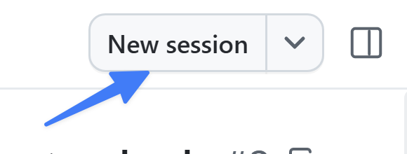

最初にプロジェクトに小さな機能を追加しました。より大きな変更には、より確実なプロセスが必要です。GitHub Copilot app は組織の既存のフローに沿って動作するよう設計されており、適切なものを正しい方法で構築できます。このレッスンから数回にわたり、一般的なエージェント主導の開発プロセスを実践します。issue を使って新機能を作成し、コードが有効で、機能が期待どおりに動作することを確かめて、最終的にプロジェクトへマージします。

> [!NOTE]
> 機能の作業は、同じセッションを使って続けます。通常はファイルの種類ごとに異なるセッションや PR を使いますが、ここでは主な概念に集中できるよう簡略化しています。

このレッスンでは、次の操作を行います。

- GitHub issue から新しいエージェントセッションを開始します。
- **Plan** モードで要件を定義します。
- **Autopilot** モードで新機能を実装します。
- コードをレビューします。
- ブラウザーキャンバスで機能を手動検証します。

この機能の作業を続けながら、リポジトリの指示を更新し、既存の `quality-checks` スキルをカスタマイズし、MCP による検証を追加して QA エージェントを作成し、機能の PR を開きます。

## シナリオ

Tailspin Toys のカタログが増え、利用者はカテゴリーやパブリッシャーでゲームを絞り込みたいと考えています。バックログの issue には機能が記載されていますが、複数カテゴリーを組み合わせる方法など、コーディング前に合意が必要な詳細もあります。Plan モードで方針を決め、範囲を限定した実装を Autopilot に任せます。

## 背景

AI コーディングエージェントを開発フローに導入しても、基本は変わりません。むしろ、より重要になります。多くの開発者は、次のような流れで作業します。

1. 必要な作業の詳細を記載した issue を開きます。
2. 構築する内容を計画します。
3. コードを構築してレビューします。
4. テストを実行してコードを検証します。
5. 新機能を手動で検証します。
6. プルリクエスト (PR) を作成します。
7. コードレビューと継続的インテグレーションプロセスが成功したら、コードをマージします。

> [!NOTE]
> 正確な手順はチームや組織によって異なりますが、多くの場合は上記の流れを調整したものになります。

この標準的な進め方に従うことで、AI が生成したコードが要件を満たし、手書きのコードと同じ審査を受けるようにできます。

## セッションモード

**セッションモード**は、エージェントにどの程度の自律性を与えるかを制御します。プロンプトフィールドの下にあるドロップダウンから設定し、いつでも切り替えられます。

- **Interactive**: エージェントと共同で作業します。エージェントは変更を提案し、次に進む前に入力を待ちます。
- **Plan**: エージェントはまず計画を作成します。実行前に計画をレビューして承認します。
- **Autopilot**: エージェントは完全に自律してコードの作成、テストの実行、反復作業を行い、入力を待ちません。

Plan モードで始め、計画をレビューしてから、Autopilot で実装します。

## issue からセッションを開始する

作業を始める前に、星評価の PR がマージされ、ローカルの `main` が最新であることを確認します。

1. サイドバーの **Sessions** の下にある Tailspin Toys リポジトリフォルダーを選択し、リポジトリの上部ナビゲーションで **Issues** を選択します。**Allow users to filter games by category and publisher** を開きます。これはすでに用意された issue なので、別の issue を作成する必要はありません。
2. **New session** を選択し、更新済みの `main` に基づく **new working tree** を選びます。

   

3. issue がセッションに添付されていることを確認し、モードセレクターで **Plan** を選択します。

> [!NOTE]
> Node.js または npm が見つからない場合は、エージェントに `node --version` と `npm --version` を実行するよう依頼します。ターミナルでは動作するのにセッションでは動作しない場合は、アプリの PATH またはバージョンマネージャーの設定を確認し、アプリを完全に終了して再起動します。失敗した操作とチェックを再試行してください。エージェントが npm を見つけられないという理由だけで再インストールしないでください。

## 絞り込み機能を計画する

計画を立てることで、Copilot がコードを書く前に進め方をレビューできます。issue から開始したため、Copilot は機能のリクエストをすでにコンテキストとして持っています。次を送信します。

```plaintext
Build this feature.
```

Copilot の質問に回答し、計画を issue の受け入れ条件に照らし合わせます。カテゴリーとパブリッシャーによる絞り込み、アクセシブルなコントロール、データアクセスの変更、テストが含まれていることを確認します。複数カテゴリーの組み合わせや、ゲームが見つからない場合の動作など、不明確な内容について話し合います。

計画には、プロジェクトの既存ツールを使った lint、ユニットテスト、E2E テスト、型チェックを含めます。絞り込みの実装とテストに範囲を絞り、品質ワークフローを終えてから PR を作成します。計画は承認前に修正を依頼し、後の検証に使えるよう issue の URL と合意事項を控えておきます。

## Autopilot を明示的に承認する

計画に納得したら、**Approve and implement this plan**、または使用中のバージョンに表示される同等のオプションを選択します。承認しただけでモードが自動的に切り替わると思い込まず、現在のモードを確認してください。モード表示が **Autopilot** になっていることを確認します。

Copilot が実装を開始します。計画に沿ってコードを生成し、テストを実行しながら作業を反復します。

> [!NOTE]
> 承認すると実装がすぐに始まる場合があるため、先に計画をレビューしてください。依存関係の不足やポート競合が報告された場合は、チェック完了と判断する前にセットアップの問題を解決します。自分が起動したサーバーだけを停止してください。

## 実装をレビューして検証する

生成されたコードは、他のコードと同じようにマージ前にレビューします。コードを確認し、サイトを実行して問題がないことを確かめましょう。

1. **Changes** を開き、絞り込みの実装とテストを確認します。
2. 複数カテゴリーとパブリッシャーの組み合わせも含め、結果を issue と承認した追加の取り決めに照らし合わせます。変更が既存のリポジトリの指示に従っていることを確認します。
3. lint、ユニットテスト、E2E テスト、型チェックの結果を確認します。スキップされたチェックは成功ではありません。
4. 実装を受け入れる前に失敗を解消し、該当するチェックを再実行します。Playwright の E2E 設定はビルドしてプレビューを配信し、ローカルサーバーを再利用できます。以前のレッスンで起動したサーバーではなく、この worktree のサーバーがテストされていることを確認します。

## 新機能を試す

コードに問題がないように見えても、実行できるでしょうか。前と同じようにアプリを起動し、ブラウザーキャンバスでサイトを開きましょう。

1. 次のプロンプトを使い、アプリを起動してブラウザーキャンバスでページを開くよう Copilot に依頼します。

   ```plaintext
   Start the app and open it in the browser canvas.
   ```

2. しばらくするとアプリが起動し、Copilot app 内にブラウザーウィンドウが開きます。
3. カテゴリーを選択して結果が一致することを確認します。フィルターを解除し、パブリッシャーを選択して、そのパブリッシャーの結果が表示されることを確認します。
4. カテゴリーとパブリッシャーを組み合わせ、issue と承認済みの計画と結果を比較します。複数カテゴリーに対応する場合は、合意した組み合わせの動作も確認します。
5. 該当するゲームがない組み合わせを試し、空の状態を確認します。フィルターを解除またはリセットして、一覧全体に戻ることも確認します。
6. 確認が終わったら、次のプロンプトを使って、このセッションで起動した開発サーバーを停止するよう Copilot に依頼します。

   ```plaintext
   Stop the dev server and close the browser canvas.
   ```

## 次のレッスンのためにセッションを保持する

絞り込みの PR はまだ作成もマージもしないでください。レッスン 4 から 8 まで、同じセッション、worktree、ブランチを使います。次はカスタム指示を絞り込みコードに適用し、スキルと QA の改善を追加してから、レッスン 8 でまとめた PR を作成してマージします。開発サーバーを停止した後、セッションを開いたままにしてもかまいません。次のレッスンでは同じセッションに戻ります。

## まとめと次のステップ

異なるエージェントモードを使って機能を構築し、レビューしました。このレッスンでは、次の操作を行いました。

- GitHub issue から新しいエージェントセッションを開始しました。
- **Plan** モードで要件を定義しました。
- **Autopilot** モードで新機能を実装しました。
- コードをレビューしました。
- ブラウザーキャンバスで機能を手動検証しました。

次は、文書化されたプラクティスにコードを従わせるために、[カスタム指示を使います][next-lesson]。

## リソース

- [GitHub Copilot app でエージェントセッションを使う][agent-sessions]

[next-lesson]: ../4-custom-instructions/
[agent-sessions]: https://docs.github.com/copilot/how-tos/github-copilot-app/agent-sessions
