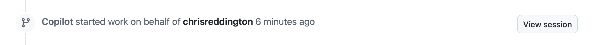

| [← Lição anterior: Instruções personalizadas][previous-lesson] |
|:--|

É provável que poucas organizações, se houver alguma, não enfrentem problemas com dívida técnica. Pode ser uma questão de segurança não resolvida, código legado que precisa de atualizações ou solicitações de recursos que ficaram paradas no backlog por falta de tempo para implementá-las. O agente de nuvem do GitHub Copilot foi criado para tarefas como atualizar código e adicionar funcionalidades de forma autônoma. Quando termina o trabalho, ele cria um pull request de rascunho para que uma pessoa desenvolvedora o revise. Isso permite delegar tarefas tediosas, acelerar o desenvolvimento e liberar as pessoas desenvolvedoras para se concentrarem em questões mais amplas.

Neste exercício, você explorará com o agente de nuvem do Copilot:

- a personalização do ambiente de geração de código.
- como garantir que as operações sejam realizadas com segurança.
- a importância de definir o escopo das issues com clareza.
- a atribuição de issues ao Copilot.

## Cenários

A Tailspin Toys tem algumas dívidas técnicas para resolver. As pessoas contratadas para criar a primeira versão do site deixaram a documentação em um estado inadequado — na verdade, você verá que ela está completamente ausente. Como primeira etapa, a equipe quer adicionar comentários TSDoc a todas as funções exportadas do aplicativo.

Além disso, a equipe de design quer melhorar a descoberta de jogos. Ela gostaria que a página de detalhes de cada jogo mostrasse outros títulos da mesma categoria, para que as pessoas pudessem continuar navegando. Ainda não é necessário criar uma implementação refinada; basta algo que a equipe possa usar para testar e aceitar a experiência do usuário. Essa tarefa está bloqueada, mas há outras issues com prioridade maior no momento.

Esses são exemplos de tarefas que podem ser facilmente despriorizadas e que são ideais para atribuir ao agente de nuvem do Copilot. Ele pode trabalhar nelas de forma assíncrona enquanto você se dedica a outras atividades. Depois, você pode revisar o trabalho para confirmar se tudo está como esperado.

## Apresentação do agente de nuvem do GitHub Copilot

O [agente de nuvem do GitHub Copilot](https://docs.github.com/copilot/concepts/agents/cloud-agent/about-cloud-agent#overview-of-copilot-cloud-agent-formerly-copilot-coding-agent) pode executar tarefas em segundo plano, de forma semelhante a uma pessoa desenvolvedora. Assim como no trabalho com outra pessoa desenvolvedora, há várias maneiras de atribuir tarefas, inclusive [atribuindo uma issue do GitHub ao Copilot](https://docs.github.com/copilot/how-tos/use-copilot-agents/cloud-agent/start-copilot-sessions). Depois de receber a atribuição, o Copilot cria um pull request de rascunho para acompanhar o progresso, configura um ambiente e começa a trabalhar. Você pode examinar a sessão enquanto o trabalho está em andamento ou depois que ela terminar. Quando a solução estiver pronta para revisão, o Copilot mencionará você no pull request.

## A importância de instruções com escopo bem definido

O GitHub Copilot não faz mágica: você ainda precisa pensar. Mesmo tarefas aparentemente simples podem se tornar complexas quando examinadas de perto. Por isso, [defina com cuidado o escopo das tarefas para o agente de nuvem do Copilot][cloud-agent-best-practices]. Trate-o como uma pessoa parceira de programação com IA: trabalhe em etapas, aprenda, experimente e adapte o processo. Os fundamentos do desenvolvimento de software não mudam com a adição da IA generativa.

## Instruções personalizadas neste repositório

Os exercícios anteriores apresentaram as instruções personalizadas e como elas orientam o Copilot. Se você já concluiu a atividade prática sobre instruções personalizadas, viu `.github/copilot-instructions.md` em ação. Caso contrário, este é um bom momento para examiná-lo rapidamente. Antes de atribuir trabalho ao agente de nuvem do Copilot, leia os arquivos de instruções incluídos neste repositório, sem alterá-los, para depois identificar seus efeitos.

Abra os seguintes arquivos na interface Web do GitHub ou em um codespace, se já houver um em execução:

- `.github/copilot-instructions.md`: examine a seção **Code standards**, principalmente as expectativas para convenções TypeScript e comentários TSDoc.
- `.github/instructions/unit-tests.instructions.md`: observe o frontmatter `applyTo`, que aplica essas instruções aos arquivos `**/*.test.ts`.

Ao atribuir a issue `Code lacks documentation` ao agente de nuvem no próximo exercício, observe no pull request os comentários TSDoc, as convenções TypeScript e os cabeçalhos de comentários. Essas orientações vêm dos arquivos de instruções que você está examinando. Falaremos disso novamente ao revisar os PRs em um exercício posterior.

## Configurar o ambiente de desenvolvimento do agente de nuvem do Copilot

Criar código, independentemente de quem o faça, normalmente exige um ambiente específico e a execução de scripts de configuração para garantir que tudo esteja pronto. O mesmo vale ao atribuir tarefas ao Copilot, que trabalha de forma semelhante a um engenheiro de software.

O agente de nuvem usa o [GitHub Actions][github-actions] como ambiente de trabalho. Você pode personalizar esse ambiente criando um [fluxo de trabalho especial de configuração][setup-workflow], definido em `.github/workflows/copilot-setup-steps.yml`, para ser executado antes do início do trabalho. Isso disponibiliza as ferramentas de desenvolvimento e dependências necessárias. Esse fluxo já foi configurado para o laboratório, facilitando o exercício e a oportunidade de aprendizado. Ele garante que o Copilot tenha acesso ao Node.js, às dependências do projeto, aos navegadores do Playwright para testes de ponta a ponta e ao banco de dados SQLite migrado e preenchido com dados para o aplicativo Astro:

```yaml
name: "Copilot Setup Steps"

# Permite testar as etapas de configuração na guia "Actions" do repositório
on: workflow_dispatch

env:
  ASTRO_TELEMETRY_DISABLED: "1"

jobs:
  copilot-setup-steps:
    runs-on: ubuntu-latest
    # Defina as permissões no nível mínimo necessário para as etapas. O Copilot receberá seu próprio token para as operações dele.
    permissions:
      # Para clonar o repositório durante as etapas de configuração, por exemplo, ao instalar dependências, será necessária a permissão `contents: read`. Se o repositório não for clonado nessas etapas, o Copilot fará isso automaticamente depois que elas forem concluídas.
      contents: read
    steps:
      - name: Checkout code
        uses: actions/checkout@v5

      # Configuração do frontend/aplicativo: Node.js (o aplicativo agora é todo Astro + Drizzle/libSQL)
      - name: Set up Node.js
        uses: actions/setup-node@v6
        with:
          node-version: "lts/*"
          cache: "npm"
          cache-dependency-path: "./package-lock.json"

      - name: Install JavaScript dependencies
        run: npm ci

      - name: Install Playwright browsers
        run: npx playwright install --with-deps chromium

      # Migra e preenche o banco de dados SQLite local para que compilações e testes tenham dados.
      - name: Set up the database
        run: npm run db:setup
```

O arquivo parece com qualquer outro fluxo de trabalho do GitHub, mas há alguns pontos importantes:

- Ele contém um único trabalho chamado `copilot-setup-steps`. Esse trabalho é executado no GitHub Actions antes de o Copilot começar a trabalhar no pull request.
- Observe o gatilho `workflow_dispatch`, que permite executar o fluxo manualmente na guia **Actions** do repositório. Isso é útil para verificar se o fluxo funciona sem precisar esperar que o Copilot o execute.

## Adicionar documentação

Todo mundo reconhece a importância da documentação, mas muitos projetos têm informações desatualizadas ou não têm documentação. Esse tipo de dívida técnica costuma ficar sem solução, o que reduz a produtividade e dificulta a manutenção da base de código ou a integração de novas pessoas à equipe. Felizmente, o Copilot é muito útil para criar documentação, e esta é uma issue ideal para atribuir ao agente de nuvem. Ele trabalhará em segundo plano para gerar a documentação necessária. Em um exercício futuro, você voltará para revisar o trabalho.

1. Em uma nova guia do navegador, acesse o repositório no github.com.
2. Selecione a guia **Issues**.
3. Selecione **New issue** para abrir a caixa de diálogo de nova issue.
4. Selecione **Blank issue** para criar uma issue em branco.
5. Defina o **Title** como `Code lacks documentation`.
6. Defina a **Description** como:

    ```plaintext
    Our organization has a requirement that functions and methods include TSDoc doc comments where helpful. Unfortunately, recent updates haven't followed this standard. We need to update the existing code to ensure doc comments are included where they clarify behavior.
    ```

7. Selecione **Create** para criar a issue.
8. À direita, selecione **Assign to Copilot** para abrir a caixa de diálogo de atribuição.

    

9. Selecione **Assign**.

    

10. Selecione a guia **Pull Requests**.
11. Abra o pull request (PR) recém-criado, com um título semelhante a `[WIP]: Code lacks documentation`. Se o novo PR ainda não aparecer na lista, aguarde um ou dois minutos e atualize a janela do navegador.
12. Depois de alguns minutos, o Copilot deverá criar uma lista de tarefas.

> [!NOTE]
> A lista de tarefas do Copilot pode levar alguns minutos para aparecer no PR. O Copilot está configurando o ambiente (executando o fluxo de trabalho mencionado anteriormente), analisando o projeto e determinando a melhor abordagem para resolver o problema.

13. Revise a lista e as tarefas que serão concluídas.
14. Role a linha do tempo do pull request para baixo. Você verá uma atualização informando que o Copilot começou a trabalhar na issue.
15. Selecione o botão **View session**.

    

> [!CAUTION]
> Talvez seja necessário atualizar a janela para ver o indicador atualizado.

16. Role a sessão em tempo real para acompanhar como o Copilot resolve o problema. Você verá o agente explorar o código e entender o estado do projeto, pausar para analisar e escolher um plano adequado e criar código.

Esse processo provavelmente levará alguns minutos. Um dos principais objetivos do agente de nuvem do Copilot é executar tarefas de forma assíncrona, liberando você para cuidar de outras atividades. Vamos aproveitar esse recurso atribuindo outra tarefa ao agente de nuvem e, em seguida, voltando nossa atenção à criação de recursos para o aplicativo.

## Adicionar uma seção de jogos relacionados à página de detalhes do jogo

Como mencionado, uma das grandes vantagens do agente de nuvem do GitHub Copilot é permitir a divisão do trabalho. Você pode se concentrar em um conjunto de tarefas enquanto ele se dedica a outro. Embora adicionar uma seção de jogos relacionados para a equipe de design talvez não leve muito tempo, você poderia usar esse tempo em outras tarefas. Vamos atribuir essa tarefa ao agente de nuvem do Copilot.

1. Volte ao repositório no github.com.
2. Selecione a guia **Issues**.
3. Selecione **New issue** para abrir a caixa de diálogo de nova issue.
4. Selecione **Blank issue** para usar o modelo em branco.
5. Defina o **Title** como `Show related games on the game details page`.
6. Defina a **Description** como:

    ```markdown
    We want to help people discover more games by showing related games on each game's details page. The design team wants to explore the UX and do some acceptance testing. Our requirements are:

   - Add a data-access helper in `src/lib/` that returns other games in the same category as a given game, excluding that game
   - Show a "Related games" section on the game details page that uses the helper
   - Handle the case where a game has no related games
   - There should be unit tests created for the new helper
   - Before creating the PR, ensure all tests pass
    ```

7. Selecione **Create** para criar a issue.
8. À direita, selecione **Assign to Copilot** para abrir a caixa de diálogo de atribuição.

    

9. Selecione **Assign**.

Logo depois, você deverá ver um 👀 no primeiro comentário da issue, indicando que o Copilot está trabalhando nela.


O Copilot agora está trabalhando na segunda solicitação. O agente de nuvem do Copilot funciona de forma semelhante a uma pessoa engenheira de software. Portanto, você não precisa acompanhá-lo ativamente; basta revisar o resultado quando estiver pronto. Agora, vamos criar e usar agentes personalizados.

## Resumo e próximos passos

Neste exercício, você explorou o [agente de nuvem do GitHub Copilot][copilot-agents]. Com ele, você pode atribuir issues ao Copilot para que sejam resolvidas de forma assíncrona. O Copilot pode ajudar a resolver dívidas técnicas, criar recursos ou migrar código de uma estrutura para outra.

Você explorou estes conceitos:

- personalizar o ambiente de geração de código.
- garantir que as operações sejam executadas com segurança.
- definir o escopo das issues com clareza.
- atribuir issues ao Copilot.

Enquanto o agente de nuvem trabalha em segundo plano, você pode se concentrar em criar e usar agentes personalizados. O [agente de nuvem do Copilot também pode usar servidores MCP][cloud-agent-mcp] e tem acesso a instruções personalizadas, que foram abordadas em módulos anteriores.

## Recursos

- [Sobre o agente de nuvem do Copilot][copilot-agents]
- [Atribuir issues do GitHub ao Copilot][assign-issue]
- [Práticas recomendadas para o fluxo de configuração do agente de nuvem do Copilot][cloud-agent-best-practices]

| [Próxima lição: Agentes personalizados →][next-lesson] |
|--:|

[previous-lesson]: ../1-custom-instructions/
[next-lesson]: ../3-custom-agents/
[cloud-agent-mcp]: https://docs.github.com/copilot/how-tos/copilot-on-github/customize-copilot/customize-cloud-agent/extend-cloud-agent-with-mcp
[assign-issue]: https://docs.github.com/copilot/how-tos/use-copilot-agents/cloud-agent/start-copilot-sessions
[setup-workflow]: https://docs.github.com/copilot/how-tos/copilot-on-github/customize-copilot/customize-cloud-agent/customize-the-agent-environment
[copilot-agents]: https://docs.github.com/copilot/concepts/agents/cloud-agent/about-cloud-agent
[cloud-agent-best-practices]: https://docs.github.com/copilot/how-tos/copilot-on-github/customize-copilot/customize-cloud-agent/customize-the-agent-environment
[github-actions]: https://docs.github.com/actions
